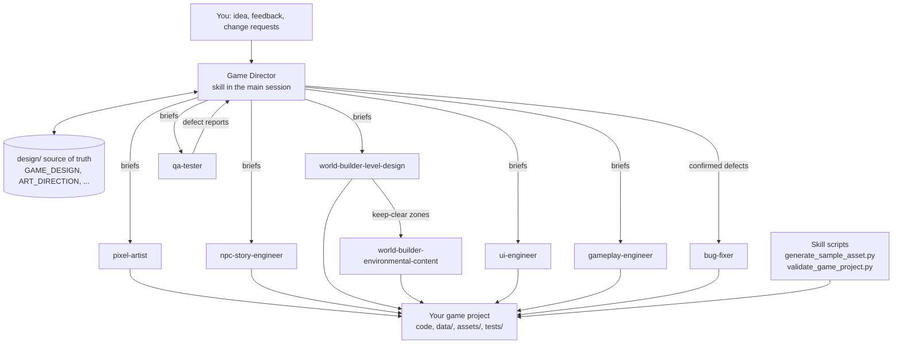

# Pixel Art Game Studio

**A Claude Code skill and specialist agent team for building original 2D pixel-art games: you describe
the game, Claude plans, codes, draws, tests, and fixes it, and reports only what it verified.**

<p align="center">
<a href="docs/i18n/en.md">English</a> ·
<a href="docs/i18n/zh-CN.md">简体中文</a> ·
<a href="docs/i18n/hi.md">हिन्दी</a> ·
<a href="docs/i18n/es.md">Español</a> ·
<a href="docs/i18n/ar.md">العربية</a> ·
<a href="docs/i18n/fr.md">Français</a> ·
<a href="docs/i18n/bn.md">বাংলা</a> ·
<a href="docs/i18n/pt.md">Português (Brasil)</a> ·
<a href="docs/i18n/id.md">Bahasa Indonesia</a> ·
<a href="docs/i18n/ur.md">اردو</a> ·
<a href="docs/i18n/ru.md">Русский</a> ·
<a href="docs/i18n/de.md">Deutsch</a> ·
<a href="docs/i18n/ja.md">日本語</a> ·
<a href="docs/i18n/pcm.md">Naijá (Nigerian Pidgin)</a> ·
<a href="docs/i18n/arz.md">مصري (Egyptian Arabic)</a> ·
<a href="docs/i18n/tr.md">Türkçe</a>
</p>

> Translations other than English are machine-assisted and awaiting community review. See
> [docs/i18n/manifest.json](docs/i18n/manifest.json) for each file's review status.

## What it is

Pixel Art Game Studio is a reusable toolkit for [Claude Code](https://code.claude.com/docs/). It
teaches Claude a disciplined game-development process for cozy narrative adventures, life and farming
simulators, dialogue-heavy RPGs, top-down exploration games, puzzle games, and other original 2D games.

**The problem it solves.** Asking an AI model to "make a game" usually produces a pile of unconnected
scripts, placeholder art, and optimistic claims. This toolkit adds what a real studio has: a director
who holds one design, specialists with clear ownership, procedural art that ends up as real PNG files,
data that can be validated, and QA that reports evidence instead of hopes.

**Who it is for.** Developers and hobbyists who want to describe the game they imagine and steer it
with feedback ("make the forest feel older", "the shopkeeper should remember me") while Claude does as
much of the implementation as the environment allows.

## Features

- **Game Director workflow** in the skill: interprets the idea, picks sensible defaults, writes a short
  design, builds a minimum playable loop first, then grows it.
- **Eight specialist subagents** with explicit ownership, tool lists, input briefs, and report formats.
- **Procedural pixel art**: a dependency-free generator turns JSON specs (rects, ellipses, lines,
  dithering, mirroring, per-frame shifts, automatic outlines) into PNG sprite sheets, metadata, and
  previews. Same spec, same bytes.
- **Engine-agnostic data contract** for maps, decor, dialogue, quests, items, and locale strings, with a
  validator that finds unreachable exits, impossible dialogue branches, missing locale keys, and
  decor that blocks paths.
- **QA and bug-fixing loop** with severity levels, defect report format, bounded retries, regression
  tests, and a release-readiness checklist.
- **Safe installer** for project or user scope with dry runs, conflict detection, backups, and an
  uninstaller that only removes files it installed.
- **Documentation in 16 languages.**

## The team

Nine roles: one coordinator plus eight subagents.

| Role | Where it lives | Owns |
| --- | --- | --- |
| Game Director | the skill ([SKILL.md](.claude/skills/pixel-art-game-studio/SKILL.md)), runs in your main session | requirements, design docs, task briefs, integration, final verdict |
| `pixel-artist` | [.claude/agents/pixel-artist.md](.claude/agents/pixel-artist.md) | art direction, asset specs, generated PNGs |
| `npc-story-engineer` | [.claude/agents/npc-story-engineer.md](.claude/agents/npc-story-engineer.md) | characters, branching dialogue, flags, quests |
| `world-builder-level-design` | [.claude/agents/world-builder-level-design.md](.claude/agents/world-builder-level-design.md) | map topology, collision, spawns, exits |
| `world-builder-environmental-content` | [.claude/agents/world-builder-environmental-content.md](.claude/agents/world-builder-environmental-content.md) | decor, points of interest, region atmosphere |
| `ui-engineer` | [.claude/agents/ui-engineer.md](.claude/agents/ui-engineer.md) | menus, HUD, dialogue box, inventory, save screens |
| `gameplay-engineer` | [.claude/agents/gameplay-engineer.md](.claude/agents/gameplay-engineer.md) | movement, state, inventory, quests, save/load |
| `qa-tester` | [.claude/agents/qa-tester.md](.claude/agents/qa-tester.md) | tests, test runs, defect reports (no game-code fixes) |
| `bug-fixer` | [.claude/agents/bug-fixer.md](.claude/agents/bug-fixer.md) | root-cause fixes plus regression tests |

Details: [docs/AGENTS.md](docs/AGENTS.md).

## Architecture



Four things are kept separate: the **skill** (instructions and references), the **agents** (specialist
definitions), the **scripts** (deterministic tools), and **your game** (a separate project directory).
Specialists never spawn other agents; the Director coordinates everything. If subagents are not
available, the Director runs the same phases itself, in order. More in
[docs/ARCHITECTURE.md](docs/ARCHITECTURE.md).

## Installation

Requirements: Claude Code, Python 3.9 or newer (standard library only), and for actual games the engine
you choose (for example Godot 4 or .NET for MonoGame). Clone this repository first:

```bash
git clone <your-fork-or-copy-url> pixel-art-game-studio
cd pixel-art-game-studio
```

**Option 1: use it right here.** This repository already contains `.claude/skills/` and
`.claude/agents/`, so running `claude` inside it makes the skill and agents available to games you
create in subfolders. Good for trying it out.

**Option 2: install into a game project** (recommended):

```bash
python scripts/install.py --scope project --project-dir ../my-game --dry-run
python scripts/install.py --scope project --project-dir ../my-game
```

**Option 3: install for all your projects** (into `~/.claude`):

```bash
python scripts/install.py --scope user --dry-run
python scripts/install.py --scope user
```

Update later with `--update` (replaced files are backed up first) and remove with `--uninstall` (only
unmodified files the installer created are removed). Cloning alone does not install anything globally.
If `.claude/agents/` did not exist when your Claude Code session started, restart the session.
Manual installation and all options: [docs/INSTALLATION.md](docs/INSTALLATION.md).

## Quick start

In the project directory, start Claude Code and invoke the skill:

```text
/pixel-art-game-studio Create an original cozy top-down pixel-art game with a small town, a forest,
three memorable NPCs, branching dialogue, a day/night cycle, two quests, and a save system.
```

Claude can also load the skill automatically when your request matches its description. To make sure a
specific specialist runs, mention it: `@agent-qa-tester run all checks and report defects`.

## Example prompts

```text
/pixel-art-game-studio Add a misty marsh region east of the forest with two NPCs and a quest that has two endings.
/pixel-art-game-studio The town feels empty. Add environmental detail and small optional discoveries, keep paths clear.
/pixel-art-game-studio Redraw the player with a 4-frame walk cycle in all four directions, same palette.
/pixel-art-game-studio Inspect this game, run all available tests, and fix reproducible bugs.
/pixel-art-game-studio Is this build ready to share? Run the release check.
```

A complete example idea, design, and session: [examples/](examples/example-game-idea.md).

## Workflows

| Workflow | File | Use for |
| --- | --- | --- |
| Create a game | [create-game.md](.claude/skills/pixel-art-game-studio/workflows/create-game.md) | new project, 14 stages from idea to delivery |
| Extend a game | [extend-game.md](.claude/skills/pixel-art-game-studio/workflows/extend-game.md) | new regions, NPCs, systems in an existing game |
| Test and fix | [test-and-fix.md](.claude/skills/pixel-art-game-studio/workflows/test-and-fix.md) | QA, triage, bounded fix cycles |
| Generate assets | [generate-assets.md](.claude/skills/pixel-art-game-studio/workflows/generate-assets.md) | procedural sprites, tiles, icons |
| Release check | [release-check.md](.claude/skills/pixel-art-game-studio/workflows/release-check.md) | evidence-based readiness verdict |

Overview: [docs/WORKFLOWS.md](docs/WORKFLOWS.md).

## Procedural art

The Pixel Artist writes one JSON spec per asset, using only named colors from the game's
`ART_DIRECTION.md`, and runs:

```bash
python .claude/skills/pixel-art-game-studio/scripts/generate_sample_asset.py --spec art/specs/hero_walk.json --out assets/sprites --preview
python .claude/skills/pixel-art-game-studio/scripts/generate_sample_asset.py --demo --out demo-assets --preview
```

Output is a sprite sheet PNG, a `.meta.json` (frames, palette, bounding boxes, clipped pixels, SHA-256),
and an 8x preview. Files with different content are never overwritten without `--force`. Structural
checks do not prove artistic quality: previews are reviewed visually when the environment can display
images, and flagged for human review when it cannot.

## QA and bug fixing

The QA Tester discovers the tools the game actually has (for example `godot --headless`, `dotnet test`),
turns acceptance criteria into tests, runs them, and writes defect reports with severity, reproduction
steps, and evidence. The Bug Fixer reproduces each confirmed defect, fixes the root cause, adds a
regression test, and reruns the checks. Deleting tests or weakening assertions is forbidden. Data checks
for any project:

```bash
python .claude/skills/pixel-art-game-studio/scripts/validate_game_project.py path/to/game
```

## Compatibility

- Skill and subagent layout follow the Claude Code documentation for
  [skills](https://code.claude.com/docs/en/skills) and [subagents](https://code.claude.com/docs/en/sub-agents)
  as checked with Claude Code 2.1.312.
- Scripts: Python 3.9+ standard library, tested on Windows; written to be portable to macOS and Linux.
- Engines: none is bundled. Godot 4, MonoGame, web canvas libraries, and pygame-ce are documented
  options; the skill checks what is installed and asks before installing anything.

## Limitations

- It does not produce finished commercial games on its own. Expect a working foundation that grows
  with your feedback, plus honest lists of what is incomplete.
- Game quality depends on the engine and tools installed; without an engine only data, assets, and
  logic that can run without one are verified.
- Procedural art follows rules and stays consistent, but taste still needs your eyes.
- Visual and feel testing requires a human playtest; the toolkit says so instead of pretending.
- Translations are machine-assisted and need native-speaker review.

## Development

```bash
python -m unittest discover -s tests -v
python scripts/validate_repository.py
python scripts/check_translations.py
```

See [docs/TESTING.md](docs/TESTING.md) and [docs/TROUBLESHOOTING.md](docs/TROUBLESHOOTING.md).

## Contributing

Issues and pull requests are welcome: [docs/CONTRIBUTING.md](docs/CONTRIBUTING.md). Please follow the
[Code of Conduct](docs/CODE_OF_CONDUCT.md). Translation reviews by native speakers are especially
valuable.

## License

[MIT](LICENSE), copyright the Pixel Art Game Studio contributors. Games you create with the toolkit are
yours; the toolkit does not claim any rights in them.

## Documentation

[Architecture](docs/ARCHITECTURE.md) · [Installation](docs/INSTALLATION.md) · [Agents](docs/AGENTS.md) ·
[Workflows](docs/WORKFLOWS.md) · [Testing](docs/TESTING.md) · [Troubleshooting](docs/TROUBLESHOOTING.md) ·
[Contributing](docs/CONTRIBUTING.md) · [Code of Conduct](docs/CODE_OF_CONDUCT.md)
